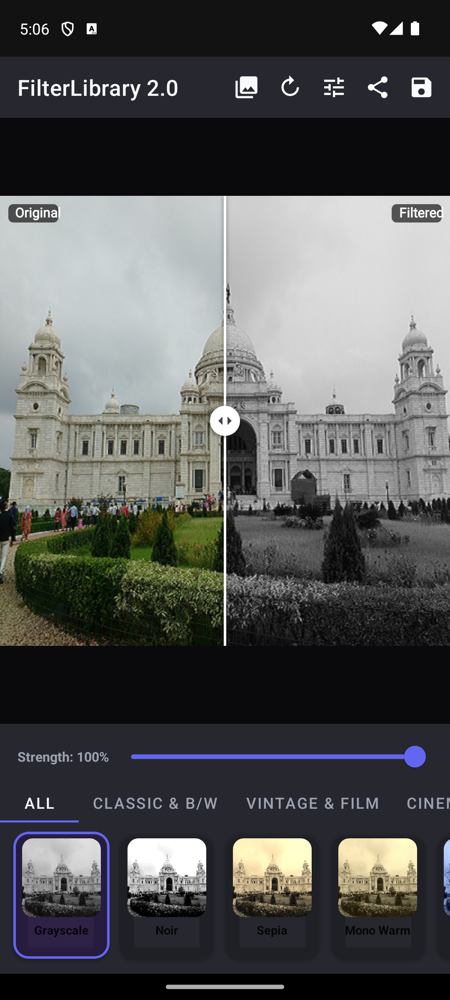
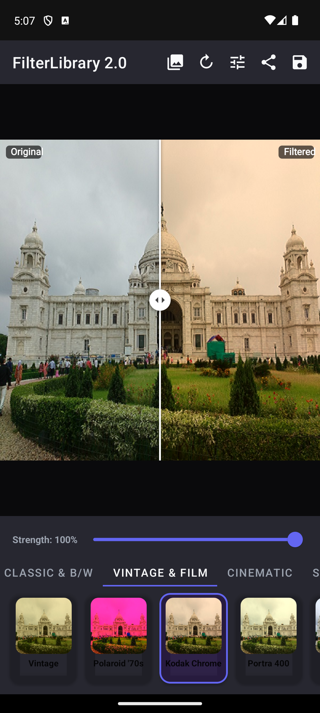
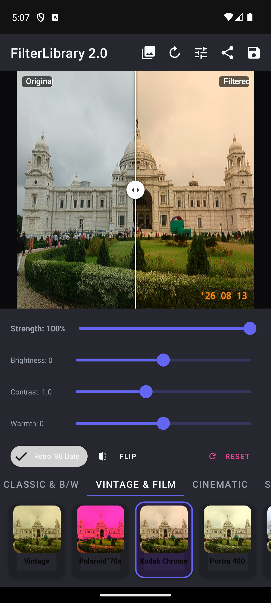
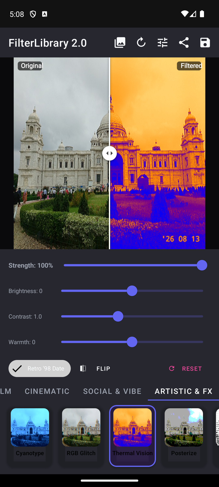

# 🎨 FilterLibrary 2.0

[](https://github.com/hgayan7/FilterLibrary/releases)
[-success.svg?style=flat-square)](https://developer.android.com)
[](https://kotlinlang.org)
[](LICENSE)
[](https://jitpack.io/#hgayan7/FilterLibrary)

**FilterLibrary** is a blazing-fast, hardware-accelerated, modern Android image filtering and color-grading engine. 

Designed for Kotlin and Java, it brings **40+ production-grade named presets**, **3D HALD LUT support (Lightroom/Photoshop)**, **Spotify-style Duotone mapping**, **Geometric transforms (Rotate/Flip/Crop)**, **1990s Analog Date Stamps & Watermarks**, **Material You Palette Extraction**, **Batch Processing**, **zero-allocation Compose/View filters**, and **Coil & Glide transformations**.

---

## 📱 Interactive Showcase

| **Interactive Split-View** | **Vintage & Analog Film** |
|:---:|:---:|
|  |  |
| *Real-time drag comparison (Grayscale)* | *Kodak Chrome Preset & Category Carousel* |

| **Pro Adjustments & Retro Date Stamp** | **Artistic & Thermal Vision FX** |
|:---:|:---:|
|  |  |
| *Fine-tuning Drawer & 90s Camera Date Stamp* | *Infrared Heatmap & Chromatic FX* |

---

## ✨ Features

- 🏎️ **Hardware-Accelerated & RenderScript-Free**: Native Canvas `ColorMatrix` and Coroutine row chunking. Zero native crashes, no context leaks, 100% compatible from Android 5.0 (API 21) through Android 15/16 (API 35+).
- 🎭 **40+ Named Filter Presets**: Categorized into *Classic & B/W*, *Vintage & Film*, *Cinematic*, *Social & Lifestyle*, and *Artistic*.
- 🎚️ **Dynamic Intensity & Blending**: Adjust effect strength seamlessly from `0.0f` (0%) to `1.0f` (100%).
- 🌈 **3D HALD LUT Support**: Drop in any 512×512 or 64×64 PNG color lookup table exported from **Adobe Lightroom**, **Photoshop**, or **DaVinci Resolve**.
- 🎨 **Duotone Gradient Mapping**: Spotify-style two-color mapping across shadows and highlights.
- 📅 **1990s Retro Date Stamps & Watermarks**: Authentic glowing amber camera date stamps and custom brand logo placement.
- 🔄 **Geometric Transforms**: Seamless non-destructive Rotate, Flip (Horizontal/Vertical), and Crop.
- 🎨 **Material You Palette Extraction**: Extract dominant and accent color swatches directly from images.
- 🚀 **Parallel Batch Processing**: Filter entire photo galleries concurrently with Kotlin Coroutines.
- 🛠️ **Pro Adjustments Suite**: Brightness, Contrast, Saturation, Temperature (Warmth), Tint, Sharpness, Vignette, and Film Grain.
- ⚡ **Zero-Allocation Mode**: Apply color filters directly to `ImageView.colorFilter` or Jetpack Compose `Modifier` without allocating or copying Bitmap memory.
- 🧵 **Kotlin Coroutines First**: Non-blocking asynchronous processing with `suspend fun Bitmap.applyFilterAsync()`.
- 🧩 **Fluent Pipeline Builder & DSL**: Chain multiple adjustments and filters in a single pass.
- 🖼️ **Image Loader Integration**: Ready-to-use transformations for **Coil** and **Glide**.
- 🔄 **100% Backward Compatible**: Legacy `photoFilter.one()` ... `photoFilter.sixteen()` are preserved and mapped to the new engine.

---

## 📦 Installation

### Step 1. Add JitPack repository

Add it to your `settings.gradle` (or root `build.gradle`):

```kotlin
dependencyResolutionManagement {
    repositories {
        google()
        mavenCentral()
        maven { url = uri("https://jitpack.io") }
    }
}
```

### Step 2. Add the dependency

In your module's `build.gradle`:

#### Kotlin DSL (`build.gradle.kts`)
```kotlin
dependencies {
    implementation("com.github.hgayan7:FilterLibrary:2.0.0")
}
```

#### Groovy (`build.gradle`)
```groovy
dependencies {
    implementation 'com.github.hgayan7:FilterLibrary:2.0.0'
}
```

---

## 🚀 Quick Start

### 1. One-Line Kotlin Extension
```kotlin
import com.uvstudio.him.photofilterlibrary.applyFilter
import com.uvstudio.him.photofilterlibrary.FilterType

// Apply filter at full intensity
val vintageBitmap = originalBitmap.applyFilter(FilterType.VINTAGE)

// Apply with 75% intensity
val sepiaBitmap = originalBitmap.applyFilter(FilterType.SEPIA, intensity = 0.75f)
```

### 2. Non-blocking Asynchronous Coroutine
```kotlin
lifecycleScope.launch {
    val filtered = originalBitmap.applyFilterAsync(FilterType.TEAL_AND_ORANGE, intensity = 0.85f)
    imageView.setImageBitmap(filtered)
}
```

### 3. Fluent Pipeline Builder & Kotlin DSL
```kotlin
import com.uvstudio.him.photofilterlibrary.photoFilter

val resultBitmap = photoFilter(originalBitmap) {
    rotate(90f)
    filter(FilterType.KODAK_PORTRA, intensity = 0.85f)
    brightness(0.05f)
    contrast(1.15f)
    warmth(0.1f)
    vignette(amount = 0.35f)
    dateStamp("'98 08 13")
}
```

### 4. Geometric Transforms (Rotate, Flip, Crop)
```kotlin
import com.uvstudio.him.photofilterlibrary.rotate
import com.uvstudio.him.photofilterlibrary.flipHorizontal
import com.uvstudio.him.photofilterlibrary.crop

val rotated = originalBitmap.rotate(90f)
val flipped = originalBitmap.flipHorizontal()
val cropped = originalBitmap.crop(left = 50, top = 50, width = 400, height = 400)
```

### 5. Retro Date Stamp & Watermark
```kotlin
import com.uvstudio.him.photofilterlibrary.applyDateStamp
import com.uvstudio.him.photofilterlibrary.applyWatermark
import com.uvstudio.him.photofilterlibrary.WatermarkPosition

// Retro 1990s amber camera timestamp
val stamped = originalBitmap.applyDateStamp("'98 04 15", position = WatermarkPosition.BOTTOM_RIGHT)

// Watermark brand logo
val watermarked = originalBitmap.applyWatermark(logoBitmap, position = WatermarkPosition.TOP_LEFT, alpha = 0.8f)
```

### 6. Dynamic Palette Extraction (Material You)
```kotlin
import com.uvstudio.him.photofilterlibrary.extractPalette

// Extract top 5 dominant colors
val palette: List<Int> = filteredBitmap.extractPalette(count = 5)
```

### 7. Parallel Batch Processing
```kotlin
import com.uvstudio.him.photofilterlibrary.applyFilterBatchAsync

lifecycleScope.launch {
    val photoGallery: List<Bitmap> = loadBitmaps()
    val filteredGallery = photoGallery.applyFilterBatchAsync(FilterType.ANIME_VIBE, intensity = 0.8f)
}
```

### 8. Zero-Allocation `ImageView` Filter (No Bitmap Copy)
```kotlin
import com.uvstudio.him.photofilterlibrary.applyFilter

// Applies directly via ColorFilter without memory overhead
imageView.applyFilter(FilterType.CYBERPUNK, intensity = 0.8f)

// Clear filter
imageView.clearFilter()
```

### 9. Jetpack Compose Integration
```kotlin
import androidx.compose.foundation.Image
import androidx.compose.ui.res.painterResource
import com.uvstudio.him.photofilterlibrary.FilterType
import com.uvstudio.him.photofilterlibrary.compose.toComposeColorFilter

Image(
    painter = painterResource(id = R.drawable.photo),
    contentDescription = "Filtered Photo",
    colorFilter = FilterType.TEAL_AND_ORANGE.toComposeColorFilter(intensity = 0.85f)
)
```

### 10. 3D HALD LUT (Lightroom / Photoshop PNG)
```kotlin
import com.uvstudio.him.photofilterlibrary.applyHaldLut

val lutBitmap = BitmapFactory.decodeResource(resources, R.drawable.my_lightroom_lut)
val gradedBitmap = originalBitmap.applyHaldLut(lutBitmap, intensity = 0.9f)
```

### 11. Duotone Mapping (Spotify-style)
```kotlin
import com.uvstudio.him.photofilterlibrary.applyDuotone
import android.graphics.Color

val duoBitmap = originalBitmap.applyDuotone(
    shadowColor = Color.rgb(15, 23, 42),    // Slate Navy
    highlightColor = Color.rgb(244, 63, 94), // Bright Rose
    intensity = 1.0f
)
```

### 12. Coil & Glide Transformations
#### Coil
```kotlin
imageView.load("https://example.com/photo.jpg") {
    transformations(PhotoFilterCoilTransformation(FilterType.VINTAGE, 0.85f))
}
```
#### Glide
```java
Glide.with(context)
    .load("https://example.com/photo.jpg")
    .transform(new PhotoFilterGlideTransformation(FilterType.CYBERPUNK, 0.85f))
    .into(imageView);
```

### 13. Java 8+ Interoperability
```java
// Synchronous
Bitmap result = PhotoFilter.apply(sourceBitmap, FilterType.VINTAGE, 0.8f);

// Asynchronous Callback
PhotoFilter.applyAsync(sourceBitmap, FilterType.SEPIA, 1.0f, new FilterCallback() {
    @Override
    public void onSuccess(@NonNull Bitmap bitmap) {
        imageView.setImageBitmap(bitmap);
    }

    @Override
    public void onError(@NonNull Throwable throwable) {
        Log.e("Filter", "Error filtering image", throwable);
    }
});

// Builder in Java
Bitmap custom = PhotoFilter.builder(sourceBitmap)
    .filter(FilterType.TEAL_AND_ORANGE, 0.9f)
    .brightness(0.1f)
    .contrast(1.2f)
    .vignette(0.4f)
    .dateStamp("'98 08 13")
    .build();
```

---

## 🎨 Filter Catalog

| Category | Filter Type | Description |
|---|---|---|
| **Classic & B/W** | `GRAYSCALE` | Clean, neutral black and white. |
| | `NOIR` | High-contrast, deep shadows and crisp highlights. |
| | `SEPIA` | Classic warm antique tone. |
| | `MONO_WARM` | Cream-tinted soft monochrome. |
| | `MONO_COOL` | Slate & steel-blue monochrome. |
| | `SILVER_TONE` | Luminous metallic silver monochrome. |
| **Vintage & Film** | `VINTAGE` | Golden retro film fade with lifted blacks. |
| | `POLAROID_70S` | Authentic 1970s instant film simulation. |
| | `KODAK_CHROME` | Punchy reds, rich saturation 1980s color slide look. |
| | `KODAK_PORTRA` | Soft pastel warmth, gentle highlight roll-off, glowing skin tones. |
| | `FUJI_VELVIA` | Deep nature greens and vibrant sky blues. |
| | `CROSS_PROCESS` | Quirky chemical cross-processing with cyan shadows. |
| | `LOMO` | Saturated center contrast with dark vignetted edges. |
| | `RETRO_WARM` | Warm golden-hour 1960s tone. |
| | `FILM_GRAIN` | Organic analog film grain texture. |
| **Cinematic** | `TEAL_AND_ORANGE` | Blockbuster complementary teal and warm amber grade. |
| | `CYBERPUNK` | Electric magenta highlights and neon cyan shadows. |
| | `BLEACH_BYPASS` | High-contrast, gritty, desaturated silver look. |
| | `WARM_SUNSET` | Golden hour glow and rich warm skin tones. |
| | `COOL_BLUE` | Serene aquatic chill and deep marine tones. |
| | `DRAMATIC` | Intense moody contrast with bold subject isolation. |
| | `ROSE_GOLD` | Dreamy soft pink highlights and warm midtones. |
| | `MOODY_DARK` | Underexposed deep forest greens with moody tone. |
| | `HIGH_KEY` | Luminous bright high-exposure ethereal look. |
| | `CINEMATIC_POP` | Dynamic color separation and punchy contrast. |
| **Social & Vibe** | `CLARENDON` | Bright highlights, deep shadows, vibrant colors. |
| | `JUNO` | Accented warm tones and healthy glowing skin. |
| | `VALENCIA` | Warm pastel antique fade. |
| | `ANIME_VIBE` | Radiant sky blues, lush greens, dreamy Makoto Shinkai highlights. |
| | `SLUMBER` | Desaturated matte finish with dreamy warm haze. |
| | `LARK` | Cool shadows with vibrant blues and greens. |
| **Artistic & FX** | `CYANOTYPE` | Historic 19th-century Prussian blue blueprint monochrome. |
| | `RGB_GLITCH_SHIFT` | Chromatic aberration / horizontal color channel displacement. |
| | `THERMAL_VISION` | Infrared heat-map color distribution (Blue to Yellow to Red). |
| | `POSTERIZE` | Quantized color levels for pop-art poster aesthetics. |
| | `COMIC_DOTS` | Pop-art vintage halftone print screen simulation. |
| | `EMBOSS` | 3D textured relief engraving. |
| | `SHARPEN` | Crisp micro-contrast and edge clarity. |
| | `SOFT_BLUR` | Optical soft-focus diffusion. |
| | `GAUSSIAN_BLUR` | Smooth variable-radius Gaussian blur. |
| | `EDGE_DETECT` | Contour sketch and outline mapping. |
| | `INVERT` | Color negative tone inversion. |
| | `SOLARIZE` | Sabatier tone reversal effect. |
| | `VIGNETTE` | Radial corner optical darkening. |
| | `DUOTONE` | Spotify-style 2-color mapping. |
| | `HALD_LUT` | 3D Color Lookup Table (Lightroom / Photoshop PNG). |

---

## 🔄 Migration from v0.1.0 to v2.0.0

| Legacy v0.1.0 Method | Modern v2.0.0 Equivalent |
|---|---|
| `photoFilter.one(context, bitmap)` | `bitmap.applyFilter(FilterType.INVERT)` |
| `photoFilter.two(context, bitmap)` | `bitmap.applyFilter(FilterType.GRAYSCALE)` |
| `photoFilter.three(context, bitmap)` | `bitmap.applyFilter(FilterType.CYAN_BOOST)` |
| `photoFilter.four(context, bitmap)` | `bitmap.applyFilter(FilterType.MOODY_DARK)` |
| `photoFilter.five(context, bitmap)` | `bitmap.applyFilter(FilterType.CROSS_PROCESS)` |
| `photoFilter.six(context, bitmap)` | `bitmap.applyFilter(FilterType.RETRO_WARM)` |
| `photoFilter.seven(context, bitmap)` | `bitmap.applyFilter(FilterType.HIGH_KEY)` |
| `photoFilter.eight(context, bitmap)` | `bitmap.applyFilter(FilterType.BRIGHTNESS_BOOST)` |
| `photoFilter.nine(context, bitmap)` | `bitmap.applyFilter(FilterType.DRAMATIC)` |
| `photoFilter.ten(context, bitmap)` | `bitmap.applyFilter(FilterType.COOL_BLUE)` |
| `photoFilter.eleven(context, bitmap)` | `bitmap.applyFilter(FilterType.POLAROID_70S)` |
| `photoFilter.twelve(context, bitmap)` | `bitmap.applyFilter(FilterType.SEPIA)` |
| `photoFilter.thirteen(context, bitmap)` | `bitmap.applyFilter(FilterType.EMBOSS)` |
| `photoFilter.fourteen(context, bitmap)` | `bitmap.applyFilter(FilterType.SOFT_BLUR)` |
| `photoFilter.fifteen(context, bitmap)` | `bitmap.applyFilter(FilterType.CINEMATIC_POP)` |
| `photoFilter.sixteen(context, bitmap)` | `bitmap.applyFilter(FilterType.WARM_SUNSET)` |

> *Note: Legacy methods still work without breaking, but are marked with `@Deprecated` guidance.*

---

## 📄 License

```
Copyright 2019 - 2026 Himshikhar Gayan

Licensed under the Apache License, Version 2.0 (the "License");
you may not use this file except in compliance with the License.
You may obtain a copy of the License at

    http://www.apache.org/licenses/LICENSE-2.0

Unless required by applicable law or agreed to in writing, software
distributed under the License is distributed on an "AS IS" BASIS,
WITHOUT WARRANTIES OR CONDITIONS OF ANY KIND, either express or implied.
See the License for the specific language governing permissions and
limitations under the License.
```
